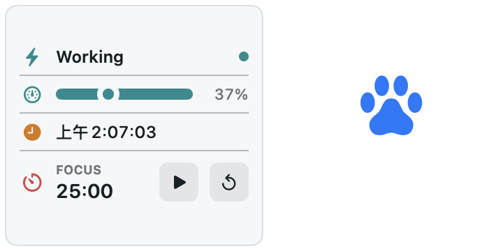
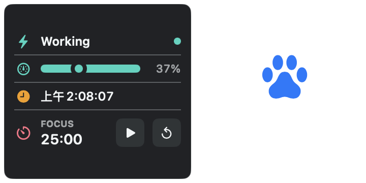
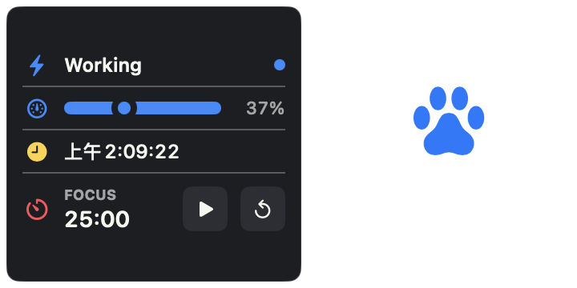
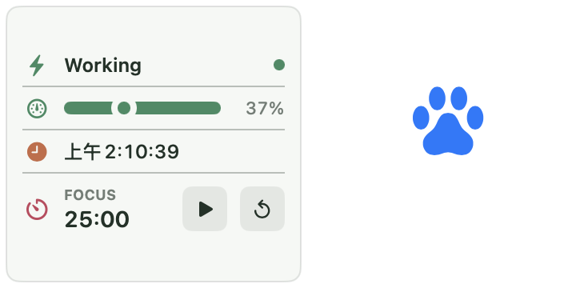

<p align="center">
  
</p>

<h1 align="center">Codex Habitat</h1>

<p align="center"><strong>A native macOS desktop companion for Codex.</strong></p>

Codex Habitat is a native macOS companion for Codex. It adds a desktop pet,
compact work widgets, local themes, a verified Petdex browser, and an optional
reversible appearance bridge without modifying the official Codex app bundle.

The first release targets macOS 14 or newer. Core pets, widgets, themes, and
timers work offline and do not require an account.

## What is included

- A non-activating desktop overlay with existing Codex pets and deterministic
  animation state mapping.
- Exact sanitized Codex activity when the local control socket is available,
  with an explicitly labelled metadata-only estimate when it is not.
- Clock, status, usage, Pomodoro, and countdown widgets in a compact rail.
- Shared menu-bar timer controls, explicit connection health, pet context
  actions, position locking, and per-display placement persistence.
- Four built-in native themes with light and dark visual directions.
- Clipboard export to the native `codex-theme-v1` import shape verified in the
  locally installed Codex build, without writing Codex preferences.
- Explicit opt-in Petdex browsing; only license-declared, hash-verified Habitat
  packages are installable.
- A versioned `.habitat-pack` protocol for portable themes, pets, assets, and
  widget configuration, with native import, explicit replacement, export, and
  uninstall workflows.
- An optional CDP appearance bridge that verifies the official Codex signature,
  binds to loopback only, checks layout health, and restores normal Codex on
  failure.
- Seven-day structured diagnostics with deterministic redacted export and local
  cache recovery.
- Hardened app/DMG packaging, Sparkle 2.9.4 signed-feed support, Developer ID
  signing, and notarization automation.

## Themes

| Workbench | Night Shift |
| --- | --- |
|  |  |

| Arcade Signal | Quiet Garden |
| --- | --- |
|  |  |

## Build and run

```bash
swift test
scripts/build-app.sh --adhoc
open "dist/Codex Habitat.app"
```

Create a local DMG with:

```bash
scripts/package-dmg.sh
```

The generated app and DMG are ad-hoc signed for local testing. Public builds
must use the Developer ID and notarization flow in
[`docs/releasing.md`](docs/releasing.md).

## Privacy boundary

Codex Habitat does not read prompts, responses, command text, project files,
authentication tokens, or raw thread identifiers. When Codex exposes its local
control socket, payloads are reduced at the connector boundary to activity,
timestamps, rate-limit percentages, and salted thread hashes. Otherwise,
Habitat opens no session file: it inspects only the size and modification date
of today's and yesterday's local session files and labels the result **Local
activity estimate**. Petdex network access is disabled until the user opts in.
Update checks are disabled in debug and ad-hoc builds.

Local files live under:

```text
~/Library/Application Support/Codex Habitat/
```

Diagnostics accept only fixed module names, stable codes, numeric versions,
and timestamps. Export drops unknown fields and refuses symbolic-link targets.

## Optional Codex appearance bridge

The bridge is disabled by default. Enabling it shows a restart confirmation,
verifies bundle ID `com.openai.codex`, Team ID `2DC432GLL2`, code signature,
architecture, process ancestry, and loopback listener ownership before any
style is installed.

The current compatibility profile supports Codex versions from `26.707.0`
through, but not including, `26.708.0`. Unknown versions fail closed. See the
[`CDP compatibility matrix`](docs/qa/cdp-compatibility-matrix.md) and use
**Settings > Privacy > Restore Official Appearance** for recovery.

## Resource packs

The portable v1 contract is defined in
[`Schemas/habitat-pack-v1.schema.json`](Schemas/habitat-pack-v1.schema.json).
Packages are static archives only: active content, executable permissions,
symlinks, traversal paths, remote CSS, oversized images, undeclared files, and
hash mismatches are rejected before atomic installation.

## Verification evidence

- [`macOS v1 QA checklist`](docs/qa/macos-v1-checklist.md)
- [`Codex runtime compatibility`](docs/qa/codex-runtime-compatibility.md)
- [`visual reference notes`](Tests/VisualReferences/README.md)
- [`asset provenance`](docs/asset-provenance.md)
- [`release procedure`](docs/releasing.md)

## Research and dependencies

The design was informed by
[Codex Dream Skin](https://github.com/Fei-Away/Codex-Dream-Skin) and
[Petdex](https://github.com/crafter-station/petdex), plus the native pet,
theme-gallery, status-surface, and app-server projects compared in the
[`open-source landscape`](docs/research/open-source-landscape.md). No Dream
Skin injector or theme CSS is copied. Runtime dependencies are pinned and documented in
[`THIRD_PARTY_NOTICES.md`](THIRD_PARTY_NOTICES.md).

Codex Habitat is an independent project and is not affiliated with or endorsed
by OpenAI. Codex and OpenAI names and marks belong to their respective owner.
