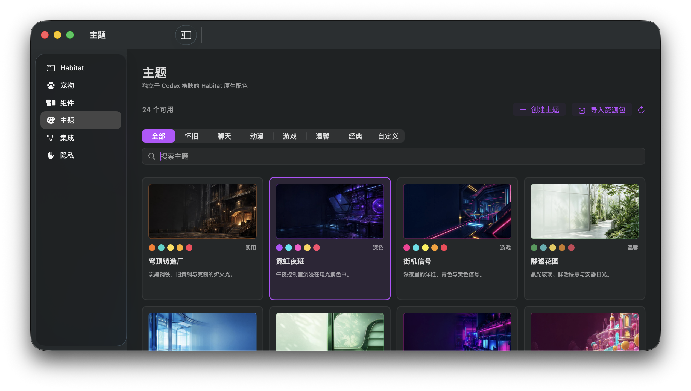

<p align="center">
  
</p>

<h1 align="center">Codex Habitat</h1>

<p align="center"><strong>A native macOS desktop companion for Codex.</strong></p>

Codex Habitat is a native macOS companion for Codex. It adds a desktop pet,
compact work widgets, local themes, a verified Petdex browser, and an optional
reversible appearance bridge without modifying the official Codex app bundle.

The first release targets macOS 14 or newer. Core pets, widgets, themes, and
timers work offline and do not require an account.

## What is included

- A non-activating desktop overlay with existing Codex pets and deterministic
  animation state mapping.
- Exact sanitized Codex activity when the local control socket is available,
  with an explicitly labelled metadata-only estimate when it is not.
- Status, latest-request Token count, request context utilization, recent
  60-second output, and account quota widgets in the default compact rail.
  Task-cumulative Token use remains available as secondary help text. Clock,
  Pomodoro, and countdown remain optional.
- A right-anchored pet overlay that is approximately 136 x 144 collapsed and
  324 x 144 expanded at 100% scale, without an invisible interaction region.
- Reliable whole-pet dragging, temporary move mode for click-through layouts,
  and per-display placement persistence.
- English and Simplified Chinese UI that follows the macOS language.
- Shared menu-bar timer controls, explicit connection health, pet context
  actions, and position locking.
- Twenty-four original built-in themes across nine host-owned style families,
  with route-aware home/task treatments and searchable All, Nostalgia, Anime,
  and Custom gallery views.
- A local Theme Studio that imports a single PNG, JPEG, or WebP image, exposes
  only typed home/task, material, safe-area, strength, opacity, focal-point, and
  palette controls, and saves or exports a validated `.habitat-pack` without
  applying it to Codex.
- Clipboard export to the native `codex-theme-v1` import shape verified in the
  locally installed Codex build, without writing Codex preferences.
- Explicit opt-in Petdex browsing; only license-declared, hash-verified Habitat
  packages are installable.
- A versioned `.habitat-pack` protocol for portable themes, pets, assets, and
  widget configuration, with native import, explicit replacement, export, and
  uninstall workflows.
- An optional CDP appearance bridge that verifies the official Codex signature,
  binds to loopback only, checks layout health, re-applies after renderer
  replacement, and restores normal Codex on failure or Habitat exit.
- Seven-day structured diagnostics with deterministic redacted export and local
  cache recovery.
- Hardened app/DMG packaging, Sparkle 2.9.4 signed-feed support, Developer ID
  signing, and notarization automation.

## Themes

The built-in library includes four polished route-aware prototypes: Cathedral
Foundry, Retro Messenger 2007, Arcade Signal, and Quiet Garden. They use
independent home/task art strength, safe areas, focal points, and separate
sidebar, header, and composer materials. Twenty additional original themes
cover nostalgic desktop, game, cozy, anime-energy, fantasy, cinematic, pixel,
and sports directions. Every theme has original local bitmap art and one of
nine compiler-owned style families; families change geometry, borders,
material, density, and scrims rather than only swapping colors.



Theme Studio accepts local, single-frame images only. Input is signature
checked, dimension and pixel bounded, oriented, downsampled, and re-encoded.
The generated package uses `LicenseRef-Codex-Habitat-User-Content` so saving a
theme never grants rights the user does not hold. Imports cannot contain CSS,
JavaScript, selectors, commands, URLs, symlinks, or undeclared files.
Installed custom themes can be reopened as strongly typed drafts, optionally
paired with a local pet, and replaced only after an explicit collision
confirmation. PNG, JPEG, and WebP filename extensions are case-insensitive;
the decoded signature and all image bounds remain mandatory.

## Build and run

```bash
swift test
scripts/build-app.sh --adhoc
open "dist/Codex Habitat.app"
```

Create a local DMG with:

```bash
scripts/package-dmg.sh
```

The generated app and DMG are ad-hoc signed for local testing. Public builds
must use the Developer ID and notarization flow in
[`docs/releasing.md`](docs/releasing.md).

## Privacy boundary

Codex Habitat does not read prompts, responses, command text, project files,
authentication tokens, or raw thread identifiers. When Codex exposes its local
control socket, payloads are reduced at the connector boundary to activity,
timestamps, rate-limit percentages, and salted thread hashes. Otherwise,
Habitat's activity fallback inspects only session-file size and modification
time. A separate bounded incremental reader binds the salted active-thread ID
to its session filename and accepts only `event_msg` records whose payload type
is `token_count`; prompt, response, command, tool, and unknown records are
discarded before their content enters the app model. Local polling and pet
animation pause while Habitat is hidden.
The Token primary value is the latest request's input plus output. Context is
`last_input_tokens / model_context_window`; recent output is the cumulative
output delta observed inside the last 60 seconds. Metrics become explicitly
unavailable after five minutes without a matching Token event.
Petdex network access is disabled until the user opts in. Update checks are
disabled in debug and ad-hoc builds.

Local files live under:

```text
~/Library/Application Support/Codex Habitat/
```

Diagnostics accept only fixed module names, stable codes, numeric versions,
and timestamps. Export drops unknown fields and refuses symbolic-link targets.

## Optional Codex appearance bridge

The bridge is disabled by default. Enabling it shows a restart confirmation,
verifies bundle ID `com.openai.codex`, Team ID `2DC432GLL2`, code signature,
architecture, process ancestry, and loopback listener ownership before any
style is installed. Built-in background art is local, bounded, and host-owned;
validated custom-theme art is single-frame, hash-checked, pixel-bounded, and
limited to PNG, JPEG, or WebP. Resource packs still cannot provide CSS,
JavaScript, selectors, commands, or remote URLs.

After a successful apply, the helper watches for new verified `app://` page
targets while Habitat is running. Quitting Habitat restores the official
appearance and closes the recorded debugging session.

The current compatibility profiles support `26.707.0` to `<26.708.0` and
`26.715.0` to `<26.716.0`. Unknown and intervening versions fail closed. See the
[`CDP compatibility matrix`](docs/qa/cdp-compatibility-matrix.md) and use
**Settings > Privacy > Restore Official Appearance** for recovery.

## Resource packs

The portable v1 contract is defined in
[`Schemas/habitat-pack-v1.schema.json`](Schemas/habitat-pack-v1.schema.json).
Packages are static archives only: active content, executable permissions,
symlinks, traversal paths, remote CSS, oversized images, undeclared files, and
hash mismatches are rejected before atomic installation.

## Verification evidence

- [`macOS v1 QA checklist`](docs/qa/macos-v1-checklist.md)
- [`Codex runtime compatibility`](docs/qa/codex-runtime-compatibility.md)
- [`native theme and overlay screenshots`](docs/qa/screenshots/2026-07-17/README.md)
- [`polished theme prototype screenshots`](docs/qa/screenshots/2026-07-18/README.md)
- [`theme asset provenance`](docs/qa/theme-asset-provenance.md)
- [`visual reference notes`](Tests/VisualReferences/README.md)
- [`other asset provenance`](docs/asset-provenance.md)
- [`release procedure`](docs/releasing.md)

## Research and dependencies

The design was informed by
[Codex Dream Skin](https://github.com/Fei-Away/Codex-Dream-Skin) and
[Petdex](https://github.com/crafter-station/petdex), plus the native pet,
theme-gallery, status-surface, and app-server projects compared in the
[`open-source landscape`](docs/research/open-source-landscape.md). No Dream
Skin injector or theme CSS is copied. Runtime dependencies are pinned and documented in
[`THIRD_PARTY_NOTICES.md`](THIRD_PARTY_NOTICES.md).

Codex Habitat is an independent project and is not affiliated with or endorsed
by OpenAI. Codex and OpenAI names and marks belong to their respective owner.
